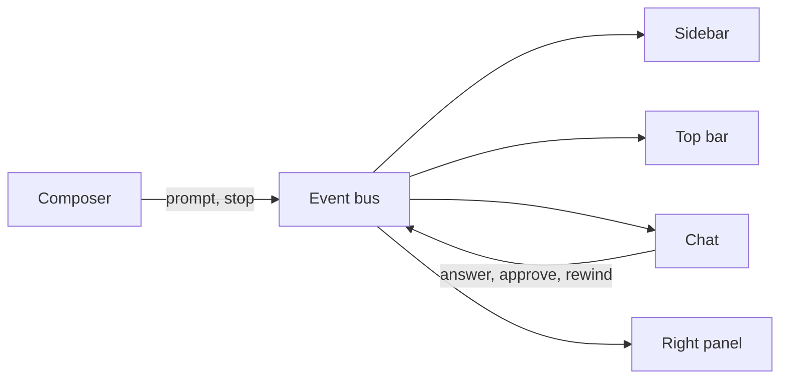

# GUI

Same layout and behavior as Claude Code, with our own name, logo and colors. Built with Qt 6 Widgets.

- Left sidebar with New, Search, Projects, Peers, Pinned and Recents. Recents show sessions from every node, tagged by node; live local sessions with a running turn show a compact running indicator (yielding to the waiting badge while a decision needs input)
- Top bar with project / session breadcrumb and a node indicator showing where the session runs and if it is online
- Center chat with streaming text and collapsed tool rows ("Read 3 files 12s ›") that expand on click
- Composer with stop button, model, effort and mode pickers, `/` commands and `@` file mentions; each session keeps its own unsent text. While the shown session's turn runs, a working line above the editor shows what the agent does ("Thinking…", the running tool's title, "Working…", "Starting session…") with a spinner, omp's accent shimmer, the elapsed time and the Esc hint; it hides while a decision card waits
- Right panel for diffs, files, terminal, subagents, the session tree and surfaces
- Escape to interrupt, queue messages mid turn, inline approvals, **Rewind** on user messages, command palette
- Drag within a transcript message to select text, then press Ctrl+C (Cmd+C on macOS). **Copy message** copies the original message, including Markdown; **Copy code block** copies just the code with its indentation.
- Agents panel showing subagents and background jobs live, including anything omp's `wait` is blocked on

## Decision prompts

Whenever the agent needs input, the chat shows an inline card and the turn waits until someone responds.

| Kind | Shows | Response |
| --- | --- | --- |
| Approval | Tool name with the command or a diff preview | Allow once, allow for this session, or deny with an optional reason |
| Question | A question with 2 to 4 options | Click an option (several when allowed) or type your own answer |
| Plan review | The plan as markdown | Approve, edit, or reject with feedback |
| Form | Fields declared by the harness or an MCP server | Fill in and submit |

- Number keys pick an option, Enter confirms, Esc skips or denies
- A waiting session gets a badge in the sidebar (taking precedence over the running indicator) and top bar, plus a system notification when the app is in the background
- Peers with drive access can answer. View only peers see the card but can't click it
- Every answer is recorded in the session DOM with who gave it, so replay and rewind show it
- Unattended runs can set a timeout with a default answer for each kind
- Adapters map each harness's own prompts (permission requests, ask tools, extension dialogs) onto these four kinds
