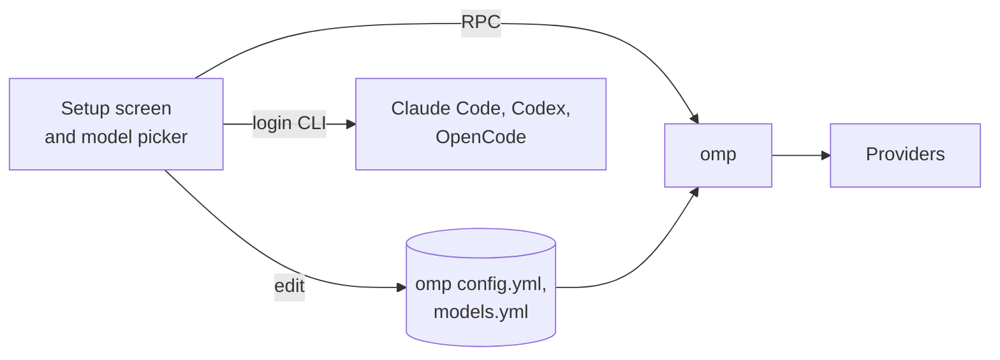

# Models and providers

The app has no model or provider code of its own. It shows omp's settings and calls omp's own mechanisms for login, model selection and side calls.

## What the app calls

| App feature | omp mechanism |
| --- | --- |
| Provider list and sign in | RPC `get_login_providers` and `login`. omp runs the OAuth flow and sends back the URL to open |
| Sign out | RPC `get_logout_accounts` lists the provider's stored credentials (label and detail only); `logout` removes the one the user picked and reports what still authenticates the provider (`remainingSource`, e.g. an environment variable) |
| Model picker | RPC `get_available_models` and `set_model` |
| Model roles, fallbacks, enabled models, provider order, overrides, custom providers | omp's own `config.yml` and `models.yml`, edited through a settings screen |
| Credentials | omp's own credential store. The app never sees or stores keys |
| Digests and titles | omp itself on the `smol` role, as a one shot `omp -p --smol` call or an RPC `btw` side turn |

- Sign in, model listing and model switching make no model calls and cost no tokens
- RPC sign in covers subscription logins (OAuth) only. omp's RPC does not accept secret prompts, so API keys go where omp already reads them (its config, an environment variable or a secret command), never through the app
- Every row with a Sign in button has a Sign out button beside it, enabled while the provider is signed in and no login runs. It lists the stored sign ins on the row, each with its own Remove, and removes nothing until one is picked. The rows are read again afterwards; the outcome, including what still signs the provider in or why removal failed, stays on the row until dismissed

The settings editor uses `loa_settings::models::settings` for its shared model and
diff-and-apply logic; omp remains the authority for provider validation. Claude
settings edits preserve JSON key order but may normalize whitespace.

## Other harnesses

- Each adapter calls its harness's own login and model commands, like `claude` and `codex` sign in
- Signing out runs the harness's own logout command (`claude auth logout`, `codex logout`), then reads its sign in state again to report a sign in that still applies (for example an API key)
- Model settings go into each harness's own config, limited to what it supports
- The app adds no provider client for them either

## Peers

- Credentials never leave a node. A peer driving a session on your node uses your omp's providers under its grant
