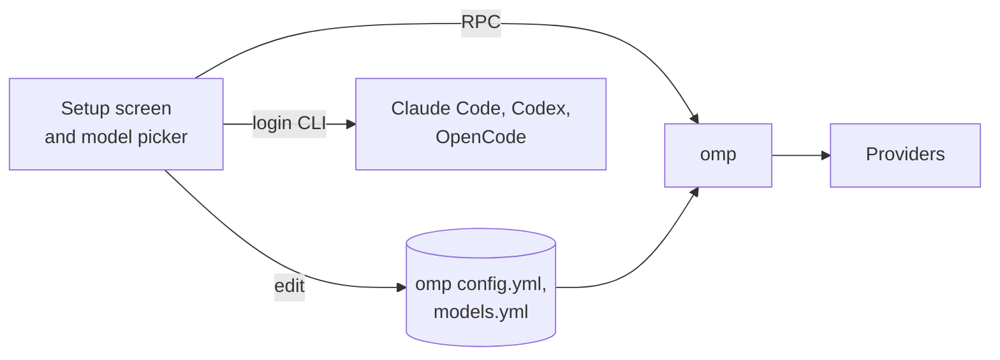

# Models and providers

The app has no model or provider code of its own. It shows omp's settings and calls omp's own mechanisms for login, model selection and side calls.

## What the app calls

| App feature | omp mechanism |
| --- | --- |
| Provider list and sign in | RPC `get_login_providers` and `login`. omp runs the OAuth flow and sends back the URL to open |
| Model picker | RPC `get_available_models` and `set_model` |
| Model roles, fallbacks, enabled models, provider order, overrides, custom providers | omp's own `config.yml` and `models.yml`, edited through a settings screen |
| Credentials | omp's own credential store. The app never sees or stores keys |
| Digests and titles | omp itself on the `smol` role, as a one shot `omp -p --smol` call or an RPC `btw` side turn |

- Sign in, model listing and model switching make no model calls and cost no tokens
- RPC sign in covers subscription logins (OAuth) only. omp's RPC does not accept secret prompts, so API keys go where omp already reads them (its config, an environment variable or a secret command), never through the app

The settings editor uses `loa_settings::models::settings` for its shared model and
diff-and-apply logic; omp remains the authority for provider validation. Claude
settings edits preserve JSON key order but may normalize whitespace.

## Other harnesses

- Each adapter calls its harness's own login and model commands, like `claude` and `codex` sign in
- Model settings go into each harness's own config, limited to what it supports
- The app adds no provider client for them either

## Peers

- Credentials never leave a node. A peer driving a session on your node uses your omp's providers under its grant
