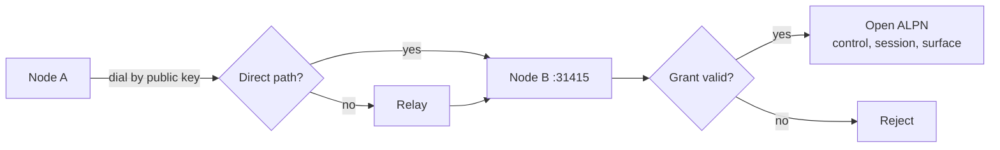

# Networking

One iroh endpoint on 31415, with traffic split by ALPN (a protocol label picked when a connection opens). iroh requires an ALPN on every connection anyway.

| ALPN | Carries |
| --- | --- |
| `omp/control/1` | Discovery, presence, grants, revocations |
| `omp/session/1` | Prompts, responses, session updates, file transfers |
| `omp/surface/1` | Surface frames and input |

- The `/1` is the protocol version. A breaking change adds `omp/session/2` and nodes use the highest version they share
- QUIC over UDP is fine. It adds delivery guarantees, TLS 1.3, and checks against spoofed addresses and amplification on top of UDP
- The real UDP risk is networks that block it (campus, corporate, hotel). TCP on 31415 covers those
- If the control and session traffic ever need separate firewall rules or rate limits, `omp/session/1` moves to its own endpoint on 9265 (3.14159265)
