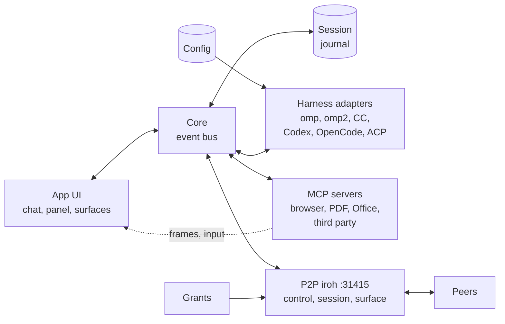

# Overview

The app owns one session format and one config format. Everything else plugs in at the edges. Harnesses plug in through adapters, tools and viewers through MCP, and other machines through the p2p network.

## Architecture map

## Patterns

| Pattern | Where it is used |
| --- | --- |
| Ports and adapters (hexagonal) | The core owns the session and config formats. Harnesses, tools and transports plug in at the edges |
| Adapter | Each harness adapter translates the shared format to and from the harness's own sessions, configs and events |
| Event sourcing | A session is an append only journal of DOM patches. Replaying it rebuilds the session DOM, a fork starts a new journal at a patch position, and a rewind diffs two DOM states |
| Snapshots | The DOM is saved every N patches, so loading a session replays only the patches after the last snapshot |
| Publish subscribe | DOM patches fan out from the journal to the UI, surfaces and peers, which all apply the same patches |
| Plugin architecture | MCP servers and surfaces load at runtime, inside or outside the app process |
| Capability negotiation | Adapters declare what each harness does natively, and the app provides the rest of omp's features on top. MCP servers declare what they support |
| Capability based security | Biscuit grants bound to node keys decide what each peer can see and do |
| Strategy | Harness, transport (QUIC or TCP fallback) and surface mode (pixel or document) are picked at runtime |
| Versioned protocols | ALPN labels and schemas carry a version (`/1`, `/2`), so old and new nodes still talk |

## Engineering practices

- Round trip tests for every adapter. Import a native session, export it, and diff against golden fixtures
- Contract tests for the adapter trait and the surface protocol, shared by every implementation
- Schema versions with migrations for the session and config formats, like omp's v1 to v3 path
- Headless UI screenshot tests in CI with Xvfb and software rendering
- A latency benchmark in CI that fails the build past 50 ms input to pixels
- Semantic versioning for the adapter, surface and grant interfaces

## Tech stack

| Layer | Pick | Why |
| --- | --- | --- |
| Language | Rust only | No TypeScript anywhere |
| UI | iced 0.14 (decided) | Working terminal (iced_term), half GPUI's build cost, slower API churn, better docs. Palette, diff, tabs and virtual list are hand built |
| Terminal panes | `alacritty_terminal` (via `iced_term`) | Alacritty's terminal emulator as a library |
| Agent engine | Harness agnostic from day one (omp, omp2, Claude Code, Codex, OpenCode, generic ACP). Every omp feature works on every harness, provided by the app where a harness lacks it | The app owns the session format, harnesses are swappable |
| P2P transport | iroh on UDP 31415, plain TCP on 31415 as fallback | Dial peers by public key, NAT traversal built in |
| Discovery | mDNS on LAN, Tailscale MagicDNS names, or add a peer by key | No central server |
| Identity | One ed25519 keypair per node in the OS keychain (`keyring`) | Same key is the network address and the signing key |
| Grants | Biscuit tokens (`biscuit-auth`), bound to the holder's key | Offline checks, narrowing on re-share, a stolen token is useless |
| Local data | SQLite (`rusqlite`) | Peers, grants, revocations, audit log |
| Wire format | Protobuf (`prost`) | Matches omp2's collab protocol |
| MCP | `rmcp` (official Rust MCP SDK) | Client for stdio and HTTP servers |
| SSH | `russh` and `russh-sftp`, keys through ssh-agent | Pure Rust, reach boxes with no app instance, private keys never touched |
