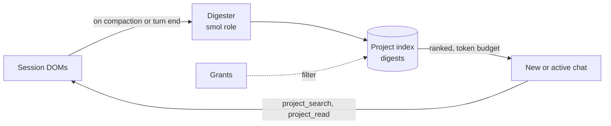

# Projects

A project groups related sessions. Every chat in a project sees a compressed digest of the other sessions' DOMs, and can search or read the real DOMs of those sessions whenever it wants more.

## OMP terminal history

Open a project with a saved folder to see **OMP terminal history**. Loa matches saved OMP conversations by their recorded working directory, not their title or the name of OMP's storage folder. Subfolders are not included. Conversations already in Loa are not listed a second time.

Opening a history row imports a snapshot into the project and opens it as a Loa chat. The original OMP file is left alone, including if it is still open in a terminal. Later changes to the terminal conversation are not synced to the imported copy.

## What a digest holds

| Part | Example |
| --- | --- |
| Summary | Two or three sentences on what the session did |
| Decisions | "Picked iced over GPUI", "31415 for control traffic" |
| Files touched | Paths with a one line note each |
| Open items | Unfinished todos and unanswered questions |
| Pointers | Node ids of the turns the digest came from |

## How it works

- Each session stores its digest as a `<digest>` element with the patch sequence it was built from. A newer patch marks it stale, and it is rebuilt at the next compaction or turn end
- Digests are written by the `smol` model role, omp's role for cheap, fast side tasks, through omp itself (a one shot `omp -p --smol` or an RPC `btw` side turn). It can be set per project, and harnesses without roles use the cheapest model their adapter exposes
- When a chat starts or compacts, the project's digests are ranked by relevance and recency and packed into a fixed token budget
- Agents can go past the digests to the real DOMs. `project_search` searches every session in the project by text or element type (every `<decision>` answer, every `<call>` that touched a file), and `project_read` pulls the full subtree behind any hit or pointer
- The project also holds shared instructions and pinned files, like a CLAUDE.md for the whole project
- Each session can be excluded from project context with a toggle
- Adapters deliver project context in each harness's own way (system prompt, context file or MCP resource), so it works on every harness
- omp's `recall` and `retain` can also read project digests

## omp's own memory

omp has a memory system with five backends (`off`, `local`, `hindsight`, `mnemopi`, `sharpshooter`), off by default. The `local` backend injects one consolidated project summary at session start. Project digests stay the main mechanism because they work on every harness and respect peer grants. In app managed omp sessions, either turn omp's memory off or feed the digests through it, so a session never gets two summaries.

## Grants and leaks

- A digest carries the grant of the session it came from. A peer only sees digests of sessions it already has access to
- A peer with a "future sessions only" grant never gets digests of older sessions through project context
- `project_read` and `project_search` check the same grant as opening the session directly, so search never returns hits from sessions the peer can't open
