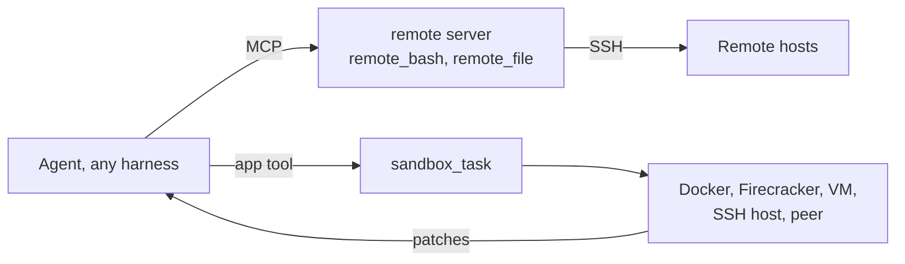

# Proposed tools

Agent features build on omp's existing tools instead of replacing them. New tools are added only where omp has nothing, and sandboxing is one more option the agent picks when a task needs it. omp's own tools are never modified, so omp updates can't break these.

## App hosted remote MCP server

Remote work ships as an MCP server the app runs itself, so every harness gets it with no per adapter work and omp's own tools stay untouched.

| Server | Tools | Does |
| --- | --- | --- |
| `remote` | `remote_bash`, `remote_file` (read, write, list, edit) | Runs commands and works on files on SSH hosts with no app instance |

- It runs inside the app, so keys stay in `ssh-agent` on the host and every call goes through the app's approval cards and per host limits
- Nothing modifies omp's tools, so omp updates can't break it

## New built in tools (omp has no equivalent)

| Tool | Does |
| --- | --- |
| `project_search`, `project_read` | Searches and reads the DOMs of sessions in the project |
| `sandbox_task` | Runs a task as a worker session inside Docker, Firecracker, a VM, an SSH host or a peer node. Mounts an ovnfs checkout when isolation is asked for and returns patches like an isolated omp task |

Built into the app and handed to every harness through its adapter. For omp they can be registered as RPC host tools (`set_host_tools`), which must use names that don't conflict with omp's built in tools.

For `sandbox_task`, model calls, API keys and the journal stay on the host. The sandbox only runs the worker's commands.

## MCP exposed tools (kept separate)

These come from MCP servers. They live under their own server in the Tools panel and are not part of the built in set.

| Server | Tools |
| --- | --- |
| `remote` (app hosted) | `remote_bash`, `remote_file` |
| Surface servers (browser, PDF, Office, VM) | `surface_screenshot`, `surface_click`, `surface_type`, `surface_scroll`, plus any structured reads the server adds |
| omp tools bridge, for non omp harnesses | Hashline edits, LSP, DAP, AST edits |
| Third party servers | Whatever they declare |

## How omp's existing tools show up in the app

Not new tools, just rendering. `ask` becomes a question decision card, `browser` and `computer` become surfaces, `task` subagents become `<job>` elements, `rewind` and `checkpoint` map onto DOM forks, and ovnfs is used as is through `task` isolation.
