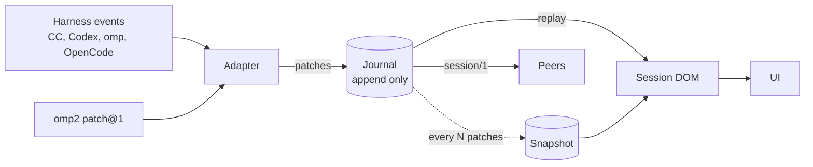

# Sessions

Each session is one DOM tree rebuilt from an append only journal of patches. Adapters turn every harness's events into patches, so the app, peers and grants all work on one format.

## Harness support

Harness agnostic from day one. Every adapter targets the same contract, and every omp feature works no matter which harness runs the session. When a harness lacks a feature, the app provides it on top.

| omp feature | Harness has it | Harness lacks it |
| --- | --- | --- |
| Fork | Adapter calls the harness's fork | App forks the DOM and starts a new harness session seeded with the translated history |
| Branch and rewind | Adapter maps to the harness's own tree | App keeps the tree in the DOM. A rewind becomes a fork at the earlier point |
| Compaction | Harness compacts, adapter records it | App writes the summary and starts a fresh harness session from it |
| Model roles | Adapter sets the model for each role | App picks the model per call where the harness allows switching |
| Subagents | Adapter maps them to `<job>` elements | App runs another harness session as a child and links it in the DOM |
| Plan mode | Adapter toggles it | App limits tools to read only and adds a plan step |
| omp tools (hashline edits, LSP, DAP, AST edits) | Built in | Served to the harness as an MCP server |
| Advisor and rules | Built in | App runs them as hooks around each turn |

Adapters planned from the start are omp, omp2 (on release), Claude Code, Codex, OpenCode and generic ACP.

The hardest features to provide on top are the ones inside the harness's own loop, like rules injected mid stream. Those depend on the hooks each harness exposes. Claude Code and Codex also use undocumented session files, so expect upkeep on those adapters.

### How the omp adapter talks to omp

omp runs as `omp --mode rpc`. The app writes one JSON command per line to omp's stdin (prompt, abort, fork, set_model, login) and reads one JSON event per line from its stdout (message_update, tool events, agent_start, agent_end, prompt_result). omp can also call the app back for host tools, host URI schemes and UI requests such as approvals. Only omp makes model calls. See omp's `docs/rpc.md`.

## Elements

| Element | Holds | Key attributes |
| --- | --- | --- |
| `<session>` | One conversation | id, harness, project, node, created |
| `<turn>` | One user prompt and everything the agent did for it | id, status |
| `<message>` | User or assistant text | role, model, status (streaming, done) |
| `<call>` | One tool call, with `<input>`, `<result>` and `<usage>` children | tool, status (pending, running, done, error, cancelled) |
| `<decision>` | Anything waiting on the user (approval, question, plan review, form) | kind, options, answer, by |
| `<job>` | A background shell or subagent | kind, status |
| `<todo>` | Plan items | state |
| `<surface>` | A surface opened during the session | uri, mode |
| `<compaction>` | A summary that replaces older turns | covers |
| `<digest>` | The session's compressed digest for project context (see projects.md) | source patch sequence |
| `<ext>` | Harness specific data with no shared element | harness, raw (keeps round trips lossless) |

## Patches

| Patch | Effect |
| --- | --- |
| `insert` | Add a node under a parent at a position |
| `set` | Set or clear an attribute |
| `append` | Append text to a node, used for streaming tokens |
| `remove` | Remove a node and its subtree |

Every patch carries a sequence number, a node id and a timestamp.

## Rules

- Node ids are stable and never reused
- One writer per session. The owner node orders the patches
- A fork is a new journal that starts at a patch position. A rewind diffs two DOM states, so removed elements are cancelled and new ones are resumed
- A snapshot every N patches (around 1,000) so loading never replays from zero
- A typed C++ tree in memory, compact protobuf patches on disk, and XML export only for debugging
- The element schema is versioned like the protocols, and each adapter declares the version it emits
- Grants select subtrees, like one `<turn>` (prompt A) or every `<session>` created after a given time
- Several people editing one session at once would need a CRDT (`loro`). Not planned
