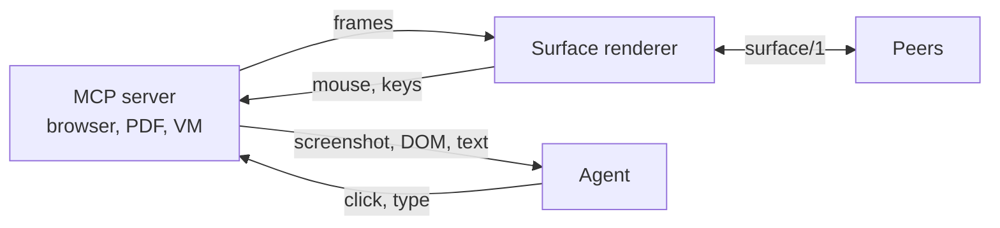

# Surfaces

Every visual thing is a surface. That includes the browser, PDFs, Office files, VMs, a peer's session and any third party MCP. An MCP server exposes it, the app renders it in the right panel with one generic renderer, and the user and the agent see and drive the same thing.

| Piece | How it works |
| --- | --- |
| Declare | The MCP server lists surfaces like `surface://browser/tab1` with a name and size |
| Stream | Frames and input go over an `omp/surface/1` ALPN on iroh, never through MCP JSON |
| Input | Mouse, scroll and keys are sent back in surface coordinates |
| Agent tools | Each surface MCP server exposes its own `surface_screenshot`, `surface_click`, `surface_type`, `surface_scroll`, plus any structured data it offers (DOM, page text, cells). The app adds no surface tools of its own |
| Peers | A grant with view or drive access lets a peer open the same surface from their own node |
| Fallback | RFB (VNC) adapter for VMs and desktops, computer use for apps with no surface |

## Modes

- Pixel mode streams frames. Used for live content like the browser and VMs
- Document mode sends the file once and the viewing app renders it locally. Used for PDF and Office files, so scroll and zoom never touch the network

## Latency budget

The hard limit is 50 ms from a click or key press to the updated pixels on screen, on the same machine and on LAN. These are targets to confirm with a benchmark.

| Step | Target |
| --- | --- |
| Input reaches the server | Under 1 ms local, 1 to 3 ms LAN |
| Server reacts and renders a frame | Up to 16 ms at 60 fps |
| Capture and hardware encode | Up to 5 ms |
| Network | Under 1 ms local, 1 to 3 ms LAN |
| Decode | Up to 3 ms |
| Shown on the next screen refresh | Up to 16 ms at 60 Hz, 8 ms at 120 Hz |
| Total | About 25 to 45 ms |

- The cursor and hover states are drawn locally and never wait on the stream. In pixel mode the pointer is a separate layer above the retained surface image.
- Frames go as QUIC datagrams. A late frame is dropped, never resent
- Live content uses low latency hardware video encoding (H.264 or HEVC). Mostly static content sends only the regions that changed
- Over the internet the floor is the network round trip plus about 35 ms. A round trip over 15 ms cannot stay under 50 ms, so the panel shows a live latency meter
- The biggest risk is Chrome's built in screencast, which sends JPEG frames paced by acknowledgements. Benchmark it first. If it misses the budget, run Chrome headed on a virtual display and capture it with a hardware encoder

## Built in surfaces

| Surface | Built with | Mode | Extra data for the agent |
| --- | --- | --- | --- |
| Browser | Headless Chrome driven by `chromiumoxide` | Pixel | DOM, page text, URL |
| PDF | `hayro` (pure Rust) | Document | Page text |
| XLSX | `calamine` to read, `rust_xlsxwriter` to write | Document | Cells |
| DOCX | `docx-rs` | Document | Text and structure |
| PPTX | `zip` + `quick-xml`, our own parser | Document | Slide text |
| Images | `image` | Document | The image |
| VM or desktop | RFB adapter | Pixel | None |

The built ins are ordinary MCP servers, so any third party MCP that implements surfaces renders the same way. MCP Apps (HTML UIs) can be added later through a webview for compatibility.
