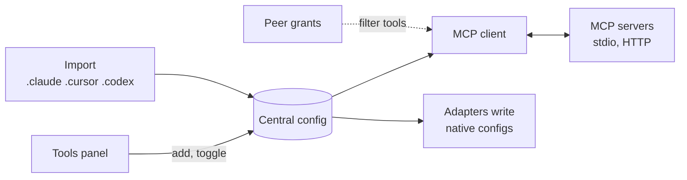

# Tools and MCP panel

A Tools button in the sidebar opens one place for everything the agent can use.

The panel has two separate sections.

| Section | Holds | Comes from |
| --- | --- | --- |
| Built in tools | Harness tools (omp's `bash`, `read`, `edit`, `task` and the rest) and app tools (`project_search`, `project_read`, `sandbox_task`) | The harness adapter and the app |
| MCP servers | Each server with its own tools and status (running, stopped, error), including surface servers (browser, PDF, Office, VM) | Registered servers, stdio or HTTP |

- MCP tools are always listed under their server, never mixed into the built in list
- Add a server by stdio command or HTTP URL, or import existing configs from `.claude`, `.cursor` and `.codex`
- Turn single tools on or off per project
- Shows which tools each peer is allowed to use through its grant

## Remote hosts (SSH)

A Remote hosts section in the same panel lets the agent reach boxes that don't run the app, to read a file, copy something over or run a command.

| Piece | How it works |
| --- | --- |
| Hosts | Import from `~/.ssh/config` (including `ProxyJump`) or add by hand |
| Keys | Uses `ssh-agent` or hardware keys (FIDO2). The app never stores or reads private key material |
| Host keys | Checked against `known_hosts`. A new or changed host key raises a decision prompt |
| Agent tools | `remote_bash` and `remote_file` from the app's `remote` MCP server. omp's own tools are not modified |
| Limits per host | Allowed paths, read only or read write, and whether commands may run |
| Approvals | Writes and commands go through the approval card unless the host allows them |
| Terminal | Open a terminal pane straight to any host |
| Audit | Every remote read, write and command is logged with the session it came from |

- Built on libssh, authenticating through ssh-agent only
- Keys never leave the node. A peer with a grant can ask this node to run an SSH tool, but the connection always starts here
- SSH access is its own grant scope, off by default for every peer
