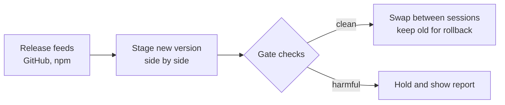

# Updater

The updater watches the app, omp and every harness the adapters use. It installs a new omp only after checking that nothing the app depends on broke.

## Gate checks

| Check | Harmful if |
| --- | --- |
| Tool schemas (old vs new) | A tool the app uses is removed, or a field it uses is renamed or made required |
| Session format version | It changes and the adapter has no migration for it |
| Config schema | A key the app writes is removed or renamed |
| RPC protocol version | It changes in a way the omp adapter doesn't support |
| Adapter contract tests | Round trip of golden sessions no longer matches |
| Changelog | The `smol` role flags a breaking or removed entry |

Additions and fixes pass. Anything harmful holds the update and shows the diff, with options to update anyway, pin the current version, or wait.

## Rules

- Updates apply between sessions, never mid turn
- The previous version stays installed for one click rollback
- App updates are signed and the signature is checked before swapping
- Archive entry parents must be real directories, not symlinks; safe links within the payload remain supported. Staged executables must resolve inside the payload.
- Peers on different versions still talk through versioned ALPNs, and the Peers list shows who is behind
- The app never patches omp or changes omp's tools. New behavior ships as new tools (RPC host tools or app hosted MCP servers)
